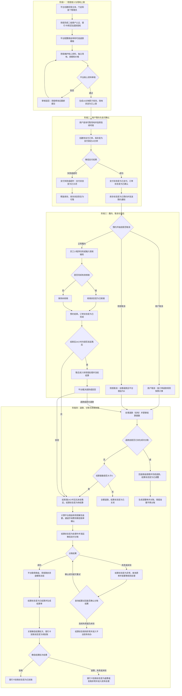
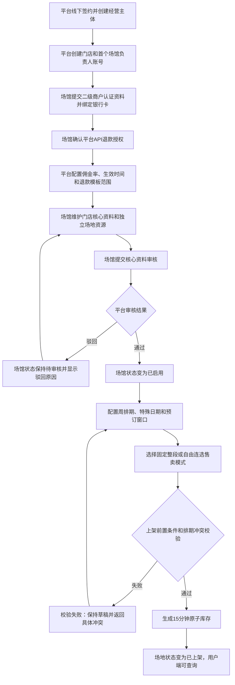
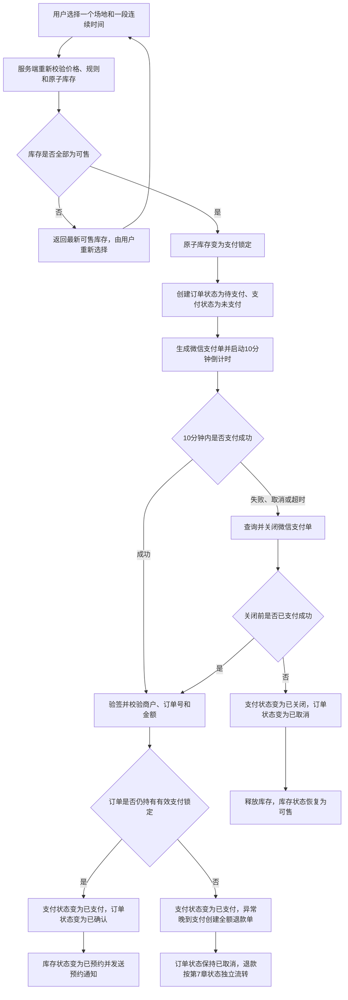
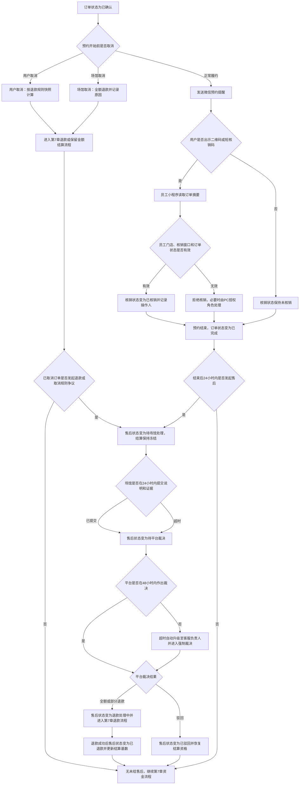
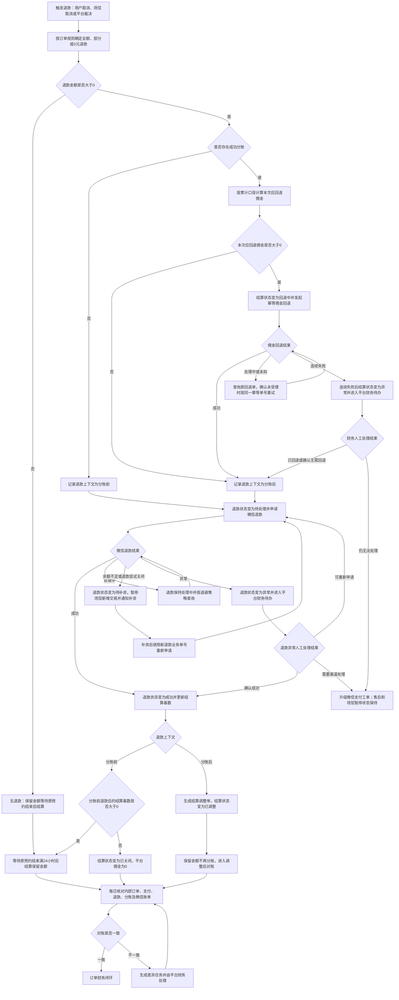

# 体育场地预约平台产品需求文档（PRD）

| 文档属性 | 内容 |
| --- | --- |
| 产品版本 | MVP V1.0 |
| 文档状态 | 待产品评审 |
| 更新日期 | 2026-08-02 |
| 运营地区 | 中国大陆 |
| 用户终端 | 微信小程序 |
| 经营终端 | PC 管理端、微信小程序员工核销入口 |
| 支付渠道 | 微信支付平台收付通 |

## 目录

1. [产品背景、目标与试点指标](#1-产品背景目标与试点指标)
2. [平台、场馆、员工和用户角色](#2-平台场馆员工和用户角色)
3. [整体业务运转流程](#3-整体业务运转流程)
4. [场馆准入、场地资源与排期发布](#4-场馆准入场地资源与排期发布)
5. [用户查询、锁单、支付与订单确认](#5-用户查询锁单支付与订单确认)
6. [取消、核销、履约与售后](#6-取消核销履约与售后)
7. [支付、退款、分账与场馆结算](#7-支付退款分账与场馆结算)
8. [业务状态定义](#8-业务状态定义)
9. [PC 管理端与微信小程序功能清单](#9-pc-管理端与微信小程序功能清单)
10. [权限、隐私、审计和异常处理](#10-权限隐私审计和异常处理)
11. [验收标准、数据指标与明确排除项](#11-验收标准数据指标与明确排除项)

---

## 1. 产品背景、目标与试点指标

### 1.1 产品背景

体育场馆在非高峰时段存在闲置资源，但传统电话、微信群和到店预约难以向用户实时展示空闲时间，也容易造成线上线下库存冲突。平台需要连接多个独立经营主体，让场馆统一发布可预约时间和价格，让用户完成查询、支付、到场核销、售后和退款，并让平台与场馆完成可追溯的自动结算。

### 1.2 产品定位

本产品是一个多场馆入驻的体育场地预约平台：

- 用户在同一个微信小程序内查询和预订不同场馆。
- 场馆通过 PC 管理端维护门店、场地、排期、价格、线下订单和内部占用。
- 场馆员工通过同一微信小程序的员工入口扫码核销，不在移动端经营场馆。
- 平台负责场馆准入、核心资料审核、佣金配置、售后裁决、支付分账和财务对账。
- 系统能力支持多城市，首发阶段仅开放一个试点城市。

### 1.3 MVP 目标

1. 建立从场馆上架到用户预约、现场履约、售后退款和场馆结算的完整交易闭环。
2. 统一线上订单、线下订单、支付锁定和内部占用，避免同一场地重复预约。
3. 支持固定整段与自由连选两种售卖方式，覆盖篮球、羽毛球、网球和足球等独占式场地。
4. 通过微信支付平台收付通实现二级商户收款、平台抽佣、退款和分账。
5. 为平台、场馆和用户提供清晰的业务状态、处理责任和异常恢复路径。

### 1.4 试点成功指标

| 指标类型 | 试点目标 |
| --- | --- |
| 供给规模 | 10 家完成支付认证并正式上架的场馆 |
| 交易规模 | 100 笔真实微信支付订单 |
| 库存正确性 | 已确认订单超卖事故为 0 |
| 资金可追溯性 | 订单、支付、退款、分账和结算记录关联率 100% |
| 业务闭环 | 所有支付、退款、售后和结算记录均可进入明确终态或异常处理队列 |
| 对账能力 | 每日识别微信账单与内部账的金额、状态和记录缺失差异 |

### 1.5 产品原则

- **库存唯一**：任何订单来源都不得绕过统一库存冲突检测。
- **支付即确认**：库存可信，用户支付成功后无需场馆二次确认。
- **规则留快照**：价格、佣金率和退款规则在下单时固化，后续修改不影响历史订单。
- **资金可核对**：所有资金变化必须能追溯到订单、支付单、退款单和分账单。
- **异常可恢复**：外部回调丢失、重复回调、余额不足或状态未知均需进入查询、重试或人工处理流程。

---

## 2. 平台、场馆、员工和用户角色

### 2.1 角色定义

| 参与方 | 角色 | 主要职责 |
| --- | --- | --- |
| 平台 | 超级管理员 | 平台配置、角色管理、全局查询和高风险操作授权 |
| 平台 | 商户运营 | 创建经营主体和门店、审核核心资料、配置佣金、启停场馆 |
| 平台 | 客服 | 受理售后、查看双方证据、作出退款或驳回裁决 |
| 平台 | 财务 | 对账、分账、退款异常、结算单和平台佣金发票处理 |
| 场馆 | 场馆负责人 | 管理经营主体下全部门店、员工和经营数据 |
| 场馆 | 店长 | 管理被授权门店的场地、排期、订单和员工 |
| 场馆 | 前台 | 处理订单、线下预约、内部占用和现场履约 |
| 场馆 | 财务 | 查看收入、退款、佣金、手续费、结算和发票数据 |
| 员工小程序 | 核销员工 | 扫码或输入短码核销，并查看本人当日核销记录 |
| 用户小程序 | 预约用户 | 查询场馆、预约支付、取消、核销、申请发票和发起售后 |
| 外部系统 | 微信支付 | 二级商户认证、支付、退款、分账、账单和银行卡结算 |

### 2.2 责任边界

- 平台创建并启用场馆，但不代替场馆维护日常排期和价格。
- 场馆对公开的场地、价格、设施、服务规则和履约负责。
- 平台对核心资料审核、平台规则、售后裁决和佣金计算负责。
- 微信支付负责实际支付、退款、分账及银行结算状态；内部系统必须以接口查询或账单结果确认资金终态。
- 员工小程序只负责核销，不允许修改排期、价格、订单、退款或结算。

### 2.3 数据可见范围

- 场馆员工只能访问所属经营主体及被授权门店的数据。
- 场馆负责人、店长和前台可查看本门店订单中的完整联系电话。
- 场馆财务和无履约职责的平台普通运营人员仅查看脱敏联系电话。
- MVP 不提供包含完整手机号的批量导出能力。

---

## 3. 整体业务运转流程



### 3.1 主流程说明

1. 平台先完成合作场馆建档、佣金配置和核心资料审核，场馆完成微信支付认证后才能上架。
2. 场馆发布的排期被拆分为统一的 15 分钟原子库存，固定整段和自由连选共用相同冲突检测。
3. 用户下单后获得 10 分钟支付锁；支付成功即确认，支付关闭后释放库存。
4. 正常订单可扫码核销；即使用户未核销，预约结束后也自动完成，但保留未核销事实供售后举证。
5. 预约结束后保留 24 小时自助售后窗口；存在未结售后时不允许发起分账。
6. 退款完成后重新计算结算基数；结算基数为 0 时不产生平台佣金和场馆结算。
7. 分账后退款只生成佣金和结算调整，不把保留金额重新送入待结算。
8. 平台的已结算表示微信分账成功，场馆银行卡到账使用独立状态跟踪。

---

## 4. 场馆准入、场地资源与排期发布

### 4.1 业务对象层级

```text
经营主体
└── 门店
    └── 独立场地资源
        ├── 周排期模板
        ├── 特殊日期覆盖
        └── 可售库存
```

- 一个经营主体可以包含多个门店。
- 一个门店可以包含多个独立场地资源。
- 每笔订单只能占用一个独立场地资源的一段连续时间。
- MVP 不支持全场与半场、多个小场合并等关联库存。

### 4.2 场馆准入流程



### 4.3 上架前置条件

场地进入已上架前必须同时满足：

- 经营主体和门店核心资料审核通过，场馆状态为已启用。
- 微信支付二级商户认证完成，结算银行卡有效。
- 场馆已确认平台 API 退款授权。
- 平台已配置有效的佣金率及生效时间。
- 门店已选择一个平台退款模板。
- 场地资源、运动分类、营业时间、售卖模式和价格完整。
- 新排期不与已确认订单、支付锁定、线下订单或内部占用重叠。

### 4.4 门店资料

| 资料类别 | 内容 | 生效规则 |
| --- | --- | --- |
| 核心资料 | 门店名称、详细地址、地图坐标、联系电话 | 新增及修改均需平台审核 |
| 展示资料 | 门店介绍、图片、交通说明、设施服务 | 场馆保存后生效并留修改记录 |
| 服务规则 | 入场须知、器材说明、停车说明、场馆责任说明 | 场馆保存后生效并留修改记录 |
| 经营属性 | 运动分类、室内或室外、营业时间 | 影响查询和排期，修改时校验未来库存 |

核心资料修改采用待审核副本，审核通过后替换线上版本；平台暂停场馆时，所有未售库存立即下架，但已确认订单必须继续履约或由场馆发起全额退款。

### 4.5 场地售卖模式

#### 固定整段

- 场馆发布明确的开始时间、结束时间和整段总价。
- 用户只能购买整个时间段，不可拆分。
- 示例：篮球场 15:00–18:00，总价 60 元。

#### 自由连选

- 场馆为场地配置预约单位，预约单位必须是 15 分钟的整数倍，范围为 15–180 分钟。
- 场馆可设置最少连续购买单位，默认 1 个单位。
- 用户只能选择连续时间，系统按覆盖的价格区间合计订单金额。
- 营业时间、价格段和可选起止时间必须与该场地的预约单位对齐。

#### 共用规则

- 同一场地资源的同一时间只能采用一种售卖模式。
- 两种模式均转换为 15 分钟原子库存后执行冲突检测。
- 单个原子库存同时只能处于可售、支付锁定、已预约或内部占用之一。

### 4.6 排期与价格

- 场馆按星期配置周排期模板，可为不同时段设置不同价格。
- 门店配置最短提前预订时间和最远可预订天数，系统滚动生成窗口内库存。
- 特殊日期可覆盖周模板，用于节假日价格、临时闭馆、维护或赛事占用。
- 特殊日期优先于周模板，不叠加执行。
- 排期或价格修改只影响尚未售出的未来库存。
- 已确认订单不得被模板修改覆盖；场馆需要取消时必须通过场馆取消订单流程全额退款。

### 4.7 线下订单与内部占用

| 类型 | 用途 | 记录内容 | 是否产生平台资金记录 |
| --- | --- | --- | --- |
| 线下订单 | 电话、到店等非小程序预约 | 联系人、电话、应收金额、实收金额、线下支付方式、备注 | 否，仅记录经营数据 |
| 内部占用 | 维护、赛事、自用、临时关闭 | 占用原因、时间、操作人、备注 | 否 |

- 两类记录都必须占用统一原子库存。
- 线下订单和内部占用不得覆盖支付锁定或已预约库存。
- 线下订单状态为待收款、已收款、已完成或已取消；线下退款状态为无退款、待退款、已退款或退款异常。
- 线下订单的收款和退款均由场馆在线下完成，系统只记录金额、方式、凭证、操作人和处理结果，不创建微信支付、平台佣金或分账记录。
- 已收款线下订单取消时必须记录应退金额；场馆确认线下退款后才能变为已退款，退款异常进入场馆财务待办。
- 线下退款规则以场馆与线下客户的约定为准，不套用平台线上订单退款模板。
- 线上和线下收入、退款及转化指标分别统计，线下订单不计入平台 GMV 和佣金。
- 取消后可释放未来库存，所有操作保留审计记录；内部占用取消后直接恢复库存，不产生订单或资金状态。

### 4.8 场馆暂停、关闭与恢复

- 暂停范围分为经营主体和单门店。支付认证、退款余额或结算账户问题默认暂停整个经营主体；内容或单店履约问题可以只暂停对应门店。
- 执行暂停时，商户运营必须选择“仅停止新增交易”或“停止履约并处理存量订单”，未选择存量订单策略不得完成暂停操作。
- 仅停止新增交易时，未售库存立即下架，已确认订单继续履约；场馆仍可访问订单、核销、售后和退款功能。
- 因停业、安全或场地不可用而停止履约时，系统批量取消受影响的未来订单、创建全额退款单、发送通知并将对应时段转为内部占用。
- 因退款待补资暂停时，默认仅停止新增交易，避免在退款资金不足时继续扩大风险；是否继续履行已有订单由商户运营在暂停时确认。
- 场馆恢复必须满足暂停原因对应的条件：待补资退款全部成功且余额校验通过、支付认证恢复有效、存量售后已处置，以及平台财务或商户运营完成复核。
- 恢复后场馆状态从已暂停变为已启用，但历史库存不自动上架；场馆需确认排期后重新发布，避免恢复过期或不可用时段。
- 场馆关闭前必须确保无未来已确认订单、无未结退款或售后、无处理中分账和未解决对账差异；否则只能保持已暂停。

---

## 5. 用户查询、锁单、支付与订单确认

### 5.1 用户查询与场馆详情

用户小程序提供：

- 当前城市识别及手动城市切换；定位授权不是浏览和下单的强制条件。
- 按运动分类、预约日期、距离、价格、室内或室外、设施条件筛选。
- 场馆列表展示名称、主图、距离、地址、运动分类和指定日期最低可售价格。
- 场馆详情展示图片、地址、导航、联系电话、设施、服务规则和可售日期。
- 排期页按场地资源展示固定整段或自由连选库存，不展示支付锁定库存。

### 5.2 登录与联系人

- 用户使用微信身份登录，无需单独设置密码。
- 用户首次下单时绑定手机号；未绑定手机号仍可浏览。
- 订单保存本次预约联系人和联系电话快照。
- 场馆只能在自身门店订单范围内访问预约联系电话。

### 5.3 交易流程



### 5.4 库存锁定规则

- 锁定时长固定为 10 分钟，从服务端创建待支付订单成功时开始计算。
- 锁定、创建订单和保存价格快照必须在同一个原子操作中完成；任一库存不可售则整笔创建失败。
- 一笔订单只允许包含一个门店、一个场地资源和一段连续时间。
- 用户不能延长锁定时间；支付失败后可在剩余时间内重新调起支付。
- 超时任务先查询并关闭微信支付单，再关闭内部订单和释放库存。
- 支付成功回调与超时任务并发时，以微信支付最终查询结果为依据，不得同时确认订单和释放库存。

### 5.5 支付成功处理

- 校验微信支付通知签名、二级商户、支付单号、内部订单号和金额。
- 重复回调必须返回成功，但不得重复确认订单、发通知或创建资金记录。
- 待支付订单且仍持有支付锁定时，原子更新为已确认、已支付和已预约。
- 已确认订单收到重复成功通知时只记录通知，不重复执行。
- 已取消订单收到真实支付成功结果时，支付状态先变为已支付并创建全额退款单，不尝试抢占已释放库存；退款结果按第 7 章独立流转，不能因退款处理中或异常而恢复订单。
- 用户支付页返回不能代替服务端支付结果，订单详情始终读取服务端状态。

### 5.6 订单快照

订单创建时保存以下不可变快照：

- 经营主体、门店、场地名称和运动分类。
- 预约开始时间、结束时间和售卖模式。
- 各价格区间、订单总价和用户实付金额。
- 退款模板版本及具体退款比例。
- 平台佣金率及生效版本。
- 场馆入场须知、服务规则版本和当时展示的关键内容。
- 平台预约协议、隐私政策版本及用户确认时间。
- 预约联系人和联系电话。

---

## 6. 取消、核销、履约与售后

### 6.1 用户主动取消规则

场馆从平台提供的模板中选择一档；订单保存下单时的模板版本。

| 模板 | 全额退款 | 50% 退款 | 不退款 |
| --- | --- | --- | --- |
| 灵活 | 距开始时间大于或等于 2 小时 | 不适用 | 距开始时间不足 2 小时 |
| 标准 | 距开始时间大于或等于 24 小时 | 大于或等于 2 小时且不足 24 小时 | 距开始时间不足 2 小时 |
| 严格 | 距开始时间大于或等于 48 小时 | 大于或等于 24 小时且不足 48 小时 | 距开始时间不足 24 小时 |

- 时间差使用服务端中国标准时间，以订单预约开始时间为基准。
- 用户只能整单取消，不支持取消部分时间。
- 取消后订单状态立即变为已取消；存在退款金额时创建退款单。
- 未来库存原则上恢复为可售；场馆取消且场地不可用时应同步创建内部占用，避免重新售卖。
- 不退款或部分退款订单的保留金额，在原预约结束满 24 小时且无未结售后后进入结算。
- MVP 不支持直接改期，用户需要取消后重新下单。

### 6.2 场馆取消

- 场馆只能整单取消已确认且尚未开始的订单。
- 场馆必须选择取消原因并填写说明。
- 场馆取消始终全额退款，平台佣金为 0。
- 系统向用户发送取消和退款通知。
- 平台记录场馆取消率，用于暂停高风险场馆，但 MVP 不设置自动罚款。

### 6.3 履约和售后流程



### 6.4 核销规则

- 用户订单页展示动态二维码和短核销码，两者对应同一核销凭证。
- 员工必须使用个人微信绑定的员工身份，且被授权到订单所属门店。
- 默认核销窗口为预约开始前 30 分钟至预约结束时间。
- 有效核销要求订单状态为已确认、未取消且核销状态为未核销。
- 核销成功后凭证立即失效，重复核销只返回首次核销结果。
- 员工小程序仅展示核销所需的订单摘要，不展示完整用户手机号。
- 异常核销和撤销只能由 PC 端有权限的场馆负责人或店长处理，必须填写原因。
- 预约结束后订单自动变为已完成；核销状态仍保持已核销或未核销。

### 6.5 售后工单

- 已完成订单可在预约结束后 24 小时内发起履约售后，填写问题类型、诉求、说明和图片证据。
- 已取消且退款金额大于 0 的订单，在退款处理期间及退款进入终态后 24 小时内均可对退款金额或退款结果发起售后。
- 已取消且退款金额为 0 的订单，可在取消后 24 小时内对退款规则计算发起售后。
- 已确认订单在预约开始后发现场馆无法提供服务时，可以立即发起“无法履约”售后，不必等待预约结束。
- 超过自助窗口仍可联系平台客服，由客服记录原因并决定是否人工建单；同一订单同一问题只能存在一个未结售后，重复工单关联原工单后关闭。
- 售后创建后立即冻结结算资格。场馆必须在 24 个自然小时内提交说明和证据；超时自动进入待平台裁决，不能因场馆未响应而无限等待。
- 平台客服必须在进入待平台裁决后 48 个自然小时内作出全额退款、部分退款或驳回决定；超时自动升级至客服负责人并进入强制裁决待办，结算继续冻结。
- 平台支持退款后，售后状态先变为退款处理中；只有相关退款全部成功后才变为已退款并释放后续资金流程。
- 用户可在平台裁决前撤回工单。撤回后售后状态变为已关闭，但只有在订单不存在其他退款义务或未结异常时才能恢复结算资格。
- 场馆不能直接关闭用户工单；平台人工关闭必须记录关闭原因，且不能借由关闭绕过已确认的退款义务。
- 所有沟通、证据、裁决、退款操作和操作人按照交易凭证及平台数据保留规则关联订单保存。

---

## 7. 支付、退款、分账与场馆结算

### 7.1 支付和资金主体

- 平台采用微信支付平台收付通的平台型支付能力。
- 每个经营主体作为微信支付二级商户，交易收款主体为对应场馆而非平台。
- 每笔订单只对应一个二级商户子单，不支持跨场馆购物车。
- 需要抽佣的订单在下单时标记为待分账，支付后资金按微信支付规则进入冻结状态。
- 场馆完成二级商户认证、银行卡绑定和平台 API 退款授权后才能开放线上支付。

### 7.2 佣金与结算公式

平台按经营主体配置佣金率及生效时间，旗下门店默认继承。订单创建时固化佣金率，后续合同调整只影响新订单。

```text
结算基数 = 用户实付金额 - 已成功退款金额
目标平台佣金 = 四舍五入到分（结算基数 × 订单固化佣金率）
平台分账金额 = 目标平台佣金
场馆解冻金额 = 结算基数 - 平台分账金额
场馆净收入 = 结算基数 - 目标平台佣金 - 微信支付通道手续费净额
```

计算规则：

- 所有金额使用人民币“分”存储和计算。
- 平台佣金计算到分并四舍五入；初次分账时平台分账金额等于目标平台佣金。
- 微信支付通道手续费由场馆承担，以微信支付账单实际扣收或退回金额为准，不由系统按固定费率推算。
- 平台分账指令只处理平台佣金，通道手续费由微信支付按渠道规则独立扣收；平台不得在分账时再次从场馆解冻金额中扣除通道手续费。
- 微信通道账单未生成前，结算单中的手续费标记为待对账；账单入库后更新实际手续费和场馆净收入，但不重新发起分账。
- 全额退款订单的结算基数和平台佣金均为 0。
- 部分退款后，只按场馆最终保留的结算基数计算平台佣金。
- 同一订单的退款按顺序串行处理，禁止两个退款同时计算佣金回退金额。

分账后发生一次或多次退款时，按累计口径计算佣金调整：

```text
当前平台实际留存佣金 = 累计成功分账佣金 - 累计成功回退佣金
退款后的目标平台佣金 = 四舍五入到分（退款后的结算基数 × 订单固化佣金率）
本次应回退佣金 = max（当前平台实际留存佣金 - 退款后的目标平台佣金，0）
```

每次计算保存计算基数、目标佣金、已留存佣金和本次应回退佣金，保证重复执行和多次部分退款不会多退或少退佣金。

示例：用户实付 60 元，无退款，订单佣金率 10%，微信支付账单实际通道手续费净额为 0.36 元。

```text
结算基数 = 60.00 元
目标平台佣金及平台分账金额 = 60.00 × 10% = 6.00 元
场馆解冻金额 = 60.00 - 6.00 = 54.00 元
场馆净收入 = 60.00 - 6.00 - 0.36 = 53.64 元
```

### 7.3 结算触发与到账

- 正常履约订单在预约结束满 24 小时且无未结售后时变为待结算。
- 用户取消但仍有保留金额的订单，也在原预约结束满 24 小时后判断结算资格。
- 售后创建与结算资格确认共用订单资金锁。结算任务在发起分账前必须再次校验售后窗口已结束且不存在未结售后；边界并发时只允许“售后创建成功并保持冻结”或“售后窗口已结束并进入分账”其中一种结果。
- 分账前全额退款成功且结算基数为 0 的订单，结算状态变为已关闭，不发起分账。
- 平台按订单计算分账金额，并按场馆和结算日生成结算批次及结算单。
- 每个订单结算版本使用唯一分账业务单号。重试前必须先查询原分账结果；仅确认渠道未受理时才使用相同幂等业务单号重试，禁止未知状态下创建新分账单。
- 发起微信分账后，结算状态变为处理中；连续 3 次可重试失败或渠道长时间无法确认结果时转为异常并进入平台财务待办。
- 微信分账成功后，平台取得佣金，场馆未分账资金解除冻结，结算状态变为已结算。
- 分账后退款不再次进入待结算：完成佣金回退和用户退款后生成结算调整单，结算状态变为已调整，保留金额不再重复分账。
- 场馆银行卡到账按微信结算批次单独记录待到账、已到账、退票或到账异常；如果渠道只提供批次级结果，则订单只关联批次，不推断单笔银行卡到账。
- 分账失败或结果未知时不得标记已结算，必须查询、按幂等规则重试或进入人工处理。

### 7.4 退款与结算异常流程



### 7.5 退款规则

- 同一订单的退款请求串行执行；前一笔退款和佣金调整未进入明确状态前，不开始下一笔退款。
- 分账前退款不发起平台佣金分账。退款成功后，剩余结算基数大于 0 才等待原预约结束后的首次结算；结算基数为 0 时结算状态变为已关闭。
- 分账后退款先按累计口径计算并回退平台多留存的佣金，再申请用户退款。退款成功后生成结算调整单，结算状态变为已调整，不重新分账保留金额。
- 分账回退和退款是两个独立外部动作，分别保存业务单号、渠道单号、幂等键、状态、请求摘要和结果。
- 佣金回退失败或结果未知时先查询原回退单；连续 3 次可重试失败后进入结算异常，由平台财务处理，未成功回退前不得发起需要该回退的用户退款。
- 退款申请受理不代表成功，只有微信支付查询或回调为成功时才更新累计已成功退款金额。
- 退款长时间处理中时按逐步延长间隔的策略主动查询，避免无限高频调用。
- 场馆账户余额不足时平台不垫资：退款变为待补资，按第 4.8 节暂停场馆新增交易，通知场馆补资，并在资金可用后使用新的退款业务单号重试。
- 单次微信退款尝试关闭后保留原尝试记录，业务退款义务不关闭；使用新的商户退款单号重新申请，并通过父退款业务号关联所有尝试。
- 退款异常由平台财务在 4 个自然小时内领取待办，并在 24 个自然小时内完成重新申请、确认成功或升级微信支付工单；售后和场馆暂停状态在退款义务完成前保持。
- 若佣金已回退但退款最终因平台重新裁决而取消，必须通过新的佣金调整单恢复应留佣金或形成场馆应收，不得直接关闭退款造成佣金少收。
- 内部退款状态只有在渠道确认成功后才能变为成功；渠道故障、余额不足或人工处理中不得把用户退款义务标记为已关闭。

### 7.6 每日对账

平台财务每天核对：

1. 内部支付单与微信支付交易账单的记录、金额和状态。
2. 内部退款单与微信退款账单的记录、金额和状态。
3. 内部分账单与微信分账结果的接收方、金额和状态。
4. 场馆结算单与订单结算基数、平台分账金额、场馆解冻金额、通道手续费和场馆净收入。
5. 已结算状态与场馆银行卡到账结果，不将分账成功误认为银行到账。

差异按缺少内部记录、缺少渠道记录、金额不一致、状态不一致和到账异常分类，并关联负责人与处理记录。

### 7.7 渠道外部资金变化同步

- 合作协议要求场馆通过平台处理线上订单退款，但系统仍必须识别场馆在微信商户平台手工退款、微信投诉退款、渠道调账及其他非平台发起的资金变化。
- 支付、退款、投诉、分账和结算账单按渠道可用频率同步；渠道记录使用二级商户号、微信交易单号、退款单号和金额进行幂等匹配。
- 匹配到内部订单的外部退款或调账，创建来源为渠道的内部资金记录，并立即冻结尚未执行的结算。
- 外部退款发生在分账前时，更新累计成功退款和结算基数；发生在分账后时，创建佣金调整单并按累计口径回退平台多留存佣金，不再次结算保留金额。
- 已进入待结算但尚未发起分账的订单，在结算任务执行前必须检查最新渠道同步水位；存在未处理渠道差异时不得分账。
- 无法匹配订单的渠道记录进入隔离差异队列，不自动修改任何订单金额；平台财务确认归属后才能入账。
- 渠道退款与平台退款以渠道退款单号去重，防止同一退款被重复累计。
- 对账差异处理结果必须是已匹配并入账、确认无业务影响、等待渠道处理或升级风险事件之一，不允许仅删除差异。

### 7.8 发票

- 用户可从订单提交发票类型、抬头、税号和接收邮箱。
- 场馆作为服务提供方，使用自身渠道开具场地服务发票，并在 5 个工作日内更新处理结果。
- 用户发票状态为待处理、处理中、已开具、已驳回、红冲中、已红冲或异常；驳回必须填写原因，用户修正资料后可以重新提交。
- 发票可开金额以订单当前用户实付减累计成功退款为准，不能超过场馆最终保留金额。
- 已开票订单发生全额退款时，场馆必须对原发票全额红冲；发生部分退款时，按税务处理能力红冲退款差额，或红冲原发票后按保留金额重开。
- 原发票、红字发票和重开发票必须相互关联。退款不等待红冲完成，但退款成功后自动创建场馆财务红冲待办，直至已红冲或异常处理完成。
- 平台按实际留存佣金向场馆开具平台服务发票；已开佣金发票对应的佣金发生回退时，平台财务同步红冲差额或重开。
- 场馆发票和平台佣金发票分别管理，不得以平台发票替代场馆向用户开具的服务发票。
- MVP 不接入自动电子发票平台，不代场馆开具用户服务发票。

---

## 8. 业务状态定义

各状态域独立保存。订单已完成不代表已核销、无售后或已结算，禁止用单一订单状态覆盖其他状态域。

### 8.1 场馆与场地状态

| 对象 | 状态 | 含义 |
| --- | --- | --- |
| 场馆 | 待配置 | 平台已建档，但资料或支付能力尚未完成 |
| 场馆 | 待审核 | 场馆已提交核心资料，等待平台审核 |
| 场馆 | 已启用 | 满足经营前置条件，可发布场地 |
| 场馆 | 已暂停 | 按暂停策略停止新增交易或履约，保留存量订单处理能力；满足恢复条件后可回到已启用 |
| 场馆 | 已关闭 | 合作终止且已通过无未结业务检查，不允许新增经营数据 |
| 场地 | 草稿 | 信息或排期未完成，用户不可见 |
| 场地 | 已上架 | 用户可查询可售库存 |
| 场地 | 已下架 | 不再生成或展示新库存，历史订单保留 |

### 8.2 订单状态

| 状态 | 进入条件 | 可离开至 |
| --- | --- | --- |
| 待支付 | 库存锁定并成功创建订单 | 已确认、已取消 |
| 已确认 | 微信支付成功且有效库存锁转为已预约 | 已完成、已取消 |
| 已完成 | 到达预约结束时间且订单未取消 | 终态，售后独立流转 |
| 已取消 | 用户取消、场馆取消、支付关闭或异常晚到支付 | 终态，退款和结算独立流转 |

### 8.3 库存状态

| 状态 | 含义 | 退出方式 |
| --- | --- | --- |
| 可售 | 用户可选择 | 下单后变为支付锁定，或被内部占用 |
| 支付锁定 | 被一笔待支付订单独占 10 分钟 | 支付后变为已预约，关闭后恢复可售 |
| 已预约 | 对应已确认订单 | 订单取消后恢复可售或转内部占用 |
| 内部占用 | 线下订单、维护、赛事或自用 | 取消占用后恢复可售 |

### 8.4 支付与退款状态

| 状态域 | 状态 | 含义 |
| --- | --- | --- |
| 支付 | 未支付 | 微信支付尚未成功 |
| 支付 | 已支付 | 已确认收到成功支付结果 |
| 支付 | 部分退款 | 累计成功退款金额大于 0 且小于实付金额 |
| 支付 | 全额退款 | 累计成功退款金额等于实付金额 |
| 支付 | 已关闭 | 未支付订单已确认关闭 |
| 退款 | 待处理 | 已创建内部退款单，尚未向微信申请或等待前置分账回退 |
| 退款 | 处理中 | 微信已受理，尚未返回终态 |
| 退款 | 待补资 | 场馆余额不足，等待补资或后续可用资金后重新申请 |
| 退款 | 成功 | 微信确认退款成功 |
| 退款 | 已关闭 | 仅用于重复申请、裁决纠正后确认无退款义务等业务关闭；渠道失败不得用此状态免除退款义务 |
| 退款 | 异常 | 无法自动完成，需要平台财务人工处理 |
| 退款尝试 | 处理中 | 某次微信退款申请已受理，等待渠道结果 |
| 退款尝试 | 成功 | 该次渠道退款成功，可累计到业务退款金额 |
| 退款尝试 | 关闭 | 该次渠道申请关闭，业务退款仍需使用新单号重试或人工处理 |
| 退款尝试 | 异常 | 该次渠道退款需要微信支付或平台财务介入 |

### 8.5 核销、售后与结算状态

| 状态域 | 状态 | 含义 |
| --- | --- | --- |
| 核销 | 未核销 | 尚无成功核销记录 |
| 核销 | 已核销 | 员工已完成有效核销 |
| 核销 | 已撤销 | 授权角色撤销核销并记录原因 |
| 售后 | 待场馆处理 | 用户已提交售后，等待场馆说明 |
| 售后 | 待平台裁决 | 场馆已处理或超时，等待平台决定 |
| 售后 | 退款处理中 | 平台已支持退款，但相关退款尚未全部成功 |
| 售后 | 已退款 | 平台支持退款且相关退款已成功 |
| 售后 | 已驳回 | 平台不支持用户退款诉求 |
| 售后 | 已关闭 | 工单撤回、重复或人工关闭 |
| 结算 | 冻结 | 未到结算时间或存在未结售后 |
| 结算 | 待结算 | 满足结束满 24 小时且无未结售后条件 |
| 结算 | 处理中 | 已发起微信分账，等待结果 |
| 结算 | 已结算 | 微信分账成功；不等同银行卡已到账 |
| 结算 | 回退中 | 已结算订单退款，正在回退平台佣金 |
| 结算 | 已调整 | 分账后退款及对应佣金回退完成，保留金额不再重复分账 |
| 结算 | 已关闭 | 分账前全额退款或结算基数为 0，无需发起分账 |
| 结算 | 异常 | 分账、回退或对账无法自动完成 |

### 8.6 佣金调整与银行卡到账状态

| 状态域 | 状态 | 含义 |
| --- | --- | --- |
| 佣金调整 | 无需回退 | 当前平台实际留存佣金不高于退款后的目标佣金 |
| 佣金调整 | 待回退 | 已计算应回退佣金，尚未调用渠道 |
| 佣金调整 | 回退中 | 已发起佣金回退，等待渠道结果 |
| 佣金调整 | 已回退 | 渠道确认对应佣金回退成功 |
| 佣金调整 | 已恢复 | 退款义务被合规纠正取消后，已恢复此前过早回退的佣金或形成已确认应收 |
| 佣金调整 | 异常 | 回退结果未知或连续失败，需要平台财务处理 |
| 银行卡到账 | 不适用 | 订单没有分账或渠道不提供订单级到账结果 |
| 银行卡到账 | 待到账 | 分账成功，等待所属微信结算批次结果 |
| 银行卡到账 | 已到账 | 微信结算账单确认批次已结算至场馆账户 |
| 银行卡到账 | 退票 | 结算款被银行退回，需要场馆修正结算账户 |
| 银行卡到账 | 到账异常 | 超过渠道结算周期仍无法确认或账单金额不一致 |

### 8.7 线下订单、线下退款与发票状态

| 状态域 | 状态 | 含义 |
| --- | --- | --- |
| 线下订单 | 待收款 | 已占用库存但场馆尚未确认收款 |
| 线下订单 | 已收款 | 场馆已记录线下实收金额和方式 |
| 线下订单 | 已完成 | 预约结束且未取消 |
| 线下订单 | 已取消 | 场馆取消线下订单，库存按规则释放 |
| 线下退款 | 无退款 | 未收款或取消后无需退款 |
| 线下退款 | 待退款 | 已收款订单取消，等待场馆线下退款 |
| 线下退款 | 已退款 | 场馆已记录退款金额、方式和凭证 |
| 线下退款 | 退款异常 | 场馆未能完成退款，需要场馆财务处理 |
| 发票 | 待处理 | 用户已提交开票申请，等待场馆处理 |
| 发票 | 处理中 | 场馆已领取申请并正在开具 |
| 发票 | 已开具 | 已记录发票代码、号码、金额和交付结果 |
| 发票 | 已驳回 | 开票资料错误或不符合条件，已记录原因 |
| 发票 | 红冲中 | 退款后等待红冲原发票 |
| 发票 | 已红冲 | 红字发票处理完成；如需重开则关联新发票 |
| 发票 | 异常 | 开票、红冲或重开无法按正常流程完成 |

---

## 9. PC 管理端与微信小程序功能清单

### 9.1 平台 PC 管理端

| 模块 | MVP 功能 |
| --- | --- |
| 工作台 | 交易、退款、售后、结算异常和待办概览 |
| 经营主体 | 创建主体、维护支付认证状态、配置佣金率、暂停策略、存量订单处置和恢复审核 |
| 门店审核 | 创建门店、审核核心资料、查看修改版本和驳回原因 |
| 场地监管 | 查看已上架场地、下架违规内容、暂停新增交易 |
| 订单中心 | 按场馆、门店、日期、订单号、用户和状态查询 |
| 售后中心 | 查看用户诉求和双方证据、全额或部分退款、驳回 |
| 退款中心 | 查询业务退款和渠道尝试、补资待办、新单号重试及异常退款处理 |
| 结算中心 | 佣金配置、待结算订单、幂等分账、佣金调整、结算单和银行卡到账状态 |
| 对账中心 | 同步微信账单及渠道外资金变化、自动匹配、冻结受影响结算、差异分类和处理记录 |
| 发票管理 | 平台佣金发票、佣金回退红冲及场馆用户发票处理情况 |
| 权限审计 | 固定平台角色、账号状态、敏感操作和数据访问记录 |
| 基础配置 | 城市、运动分类、退款模板、取消原因和售后问题类型 |

### 9.2 场馆 PC 管理端

| 模块 | MVP 功能 |
| --- | --- |
| 经营概览 | 今日订单、待核销、场地利用、收入、退款和待办 |
| 门店资料 | 展示资料、核心资料变更提交和审核状态 |
| 场地管理 | 独立场地资源、运动分类、图片、设施和上下架 |
| 排期日历 | 周模板、特殊日期、固定整段、自由连选、价格和批量查看 |
| 订单管理 | 线上订单、线下订单及其收退款状态、详情、场馆取消和操作记录 |
| 内部占用 | 维护、赛事、自用等占用创建、修改和取消 |
| 核销管理 | 当日待核销、核销查询、异常核销和授权撤销 |
| 售后处理 | 查看用户诉求、上传说明和证据、查看平台裁决 |
| 财务中心 | 支付、退款、佣金调整、手续费、净收入、结算单、银行卡到账和线下退款待办 |
| 发票处理 | 用户开票申请、驳回、红冲、重开和关联发票记录 |
| 员工权限 | 四类预设角色、员工账号、门店范围和小程序身份绑定 |

### 9.3 用户微信小程序

| 页面或模块 | MVP 功能 |
| --- | --- |
| 首页 | 当前城市、运动分类、推荐的有库存场馆和日期入口 |
| 场馆列表 | 日期、距离、价格、室内外和设施筛选及排序 |
| 场馆详情 | 图片、地址、导航、设施、规则、电话和可售场地 |
| 预约排期 | 固定整段选择或自由连续时段选择、价格明细 |
| 确认订单 | 联系人、手机号、场地和时间、退款规则、实付金额 |
| 微信支付 | 10 分钟倒计时、支付结果和订单状态确认 |
| 订单中心 | 待支付、已确认、已完成和已取消订单列表及详情 |
| 履约凭证 | 动态二维码、短核销码、核销状态和场馆信息 |
| 取消退款 | 取消前展示退款金额、提交取消、查看退款进度 |
| 售后 | 已完成、已取消或无法履约订单提交诉求，查看 SLA、场馆反馈、平台裁决和退款结果 |
| 发票 | 提交发票资料并查看开具、驳回、红冲和异常状态 |
| 消息结果 | 预约、取消、退款、售后和结算无关的用户订单通知 |

### 9.4 员工微信小程序入口

| 功能 | 说明 |
| --- | --- |
| 员工身份绑定 | 个人微信绑定员工账号和授权门店 |
| 扫码核销 | 扫描用户订单二维码并展示最小订单摘要 |
| 短码核销 | 手工输入短核销码，适配扫码失败场景 |
| 核销确认 | 校验门店、订单、时间窗口和核销状态后确认 |
| 本人记录 | 查看本人当日核销成功和失败记录 |

员工入口不提供排期、价格、订单取消、退款、联系方式查询或财务功能。

---

## 10. 权限、隐私、审计和异常处理

### 10.1 权限控制

- 平台与场馆使用同一 PC 系统时，必须通过身份类型、经营主体和门店范围同时限制数据。
- 场馆负责人可访问主体下全部门店；店长、前台和财务只访问被授权门店。
- 客服可以处理售后，但不能修改佣金率或确认财务对账。
- 平台财务可以处理退款和结算异常，但不能修改场馆公开内容。
- 客服作出退款裁决后不能把未成功退款直接标记为已退款或已关闭；退款异常必须由平台财务处理。
- 高风险操作必须再次确认并记录操作人，包括场馆取消、平台裁决退款、异常核销、核销撤销、分账回退和场馆暂停。

### 10.2 个人信息与敏感信息

- 首次下单前说明手机号的预约联系用途并获得必要授权。
- 履约角色只能在自身门店订单中查看手机号，不允许跨门店检索用户。
- 财务页面、结算单和导出数据使用脱敏手机号。
- 用户身份证、银行卡等本业务不需要的信息不采集。
- 微信支付密钥、证书和回调报文中的敏感字段不得写入普通业务日志。
- 用户订单、手机号访问、售后证据和发票资料按照平台数据保留及删除规则管理。

### 10.3 审计范围

必须记录以下操作的操作人、时间、对象、修改前后内容、来源终端和结果：

- 场馆核心资料审核、启用、暂停策略、存量订单处置、恢复和关闭。
- 佣金率、退款模板和生效时间变更。
- 场地、排期、价格、特殊日期和内部占用变更。
- 线下订单创建、修改和取消。
- 场馆取消用户订单。
- 核销、异常核销和核销撤销。
- 售后证据、平台裁决和退款操作。
- 分账、佣金调整、异常退款、渠道外资金入账和对账差异处理。
- 发票开具、驳回、红冲、重开和异常处理。
- 完整手机号查看行为。

### 10.4 并发与幂等

- 原子库存必须以服务端持久化约束保证唯一占用，不能只依赖页面展示或缓存判断。
- 创建订单、释放库存、支付确认、取消订单和核销均使用业务幂等键。
- 微信支付、退款和分账回调按渠道单号去重。
- 分账、佣金回退和退款请求使用稳定的业务幂等单号；未知结果必须先查询原单，禁止直接换新单重试。
- 同一订单的退款及佣金调整串行执行，并以累计成功金额计算下一次调整。
- 主动查询和异步回调同时返回时，只允许一次合法状态迁移。
- 状态迁移不合法时记录异常，不覆盖已到达的更高可信状态。

### 10.5 外部能力异常

| 异常 | 系统处理 |
| --- | --- |
| 支付回调缺失 | 主动查询微信支付订单状态 |
| 支付重复回调 | 幂等返回成功，不重复确认或发通知 |
| 订单超时与支付并发 | 先查询和关闭微信支付单，再决定确认或释放库存 |
| 退款长时间处理中 | 按退避策略查询，结果未知时保持处理中并保留退款义务 |
| 退款余额不足或渠道尝试关闭 | 业务退款变为待补资、暂停场馆新增交易，补资后使用关联的新退款单重试 |
| 退款异常 | 4 小时内由财务领取，24 小时内重试、确认成功或升级微信支付工单，不提前关闭售后 |
| 分账失败或未知 | 查询原分账单，确认未受理才按同一幂等单号重试，连续失败后进入异常 |
| 佣金回退失败或未知 | 保持结算回退中，查询原回退单；未成功回退前不发起依赖该回退的用户退款 |
| 分账后退款 | 回退累计口径下的佣金差额，退款成功后生成结算调整单，不再次分账保留金额 |
| 微信商户平台手工退款或投诉退款 | 创建渠道来源资金记录、冻结相关结算并按分账前后规则更新或调整佣金 |
| 银行卡到账退票或异常 | 保持分账已结算事实，更新独立到账状态并暂停受影响主体的新结算 |
| 场馆暂停 | 执行已选择的存量订单策略；恢复前校验退款、支付认证、售后和财务复核条件 |
| 已开票订单退款 | 退款不等待红冲，成功后创建发票红冲待办并跟踪至已红冲或异常 |
| 消息发送失败 | 不影响订单主流程，用户可在订单中心查看真实状态 |
| 对账不一致 | 生成差异任务，禁止静默修改内部金额 |

### 10.6 通知

MVP 使用微信订阅消息和小程序订单中心：

- 支付成功及预约确认。
- 预约开始前提醒。
- 用户或场馆取消结果。
- 退款待补资、成功或异常进展。
- 售后状态和平台裁决。
- 发票开具、驳回、红冲或异常结果。

用户未授权订阅消息时，以订单中心状态为准。短信通知列入后续版本。

---

## 11. 验收标准、数据指标与明确排除项

### 11.1 核心验收场景

| 编号 | 场景 | 验收结果 |
| --- | --- | --- |
| VEN-01 | 场馆资料审核驳回后修改重提 | 驳回原因可见，未通过前不可上架 |
| VEN-02 | 已启用场馆发布固定整段 | 正确生成原子库存并在用户端展示整段总价 |
| VEN-03 | 场馆发布自由连选时段 | 仅允许 15 分钟倍数且 15–180 分钟的预约单位 |
| VEN-04 | 场馆因余额不足暂停后补资 | 全主体停止新增交易，退款完成并经财务复核后才能恢复 |
| VEN-05 | 场馆停止履约 | 暂停操作必须选择存量订单策略，批量取消时逐单全额退款并通知 |
| INV-01 | 两名用户同时购买同一时段 | 最多一笔订单获得支付锁定 |
| INV-02 | 线上订单与线下订单或内部占用冲突 | 后创建的一方得到明确冲突，不覆盖已有占用 |
| INV-03 | 修改周模板覆盖已确认订单 | 已确认订单保持不变，冲突修改被拒绝 |
| ORD-01 | 待支付订单 10 分钟未付款 | 先关闭支付单，再取消订单并释放库存 |
| ORD-02 | 支付成功与超时任务并发 | 最终只有已确认或已取消加全额退款一种结果 |
| ORD-03 | 重复支付回调 | 不重复确认、占用库存、记账或发送通知 |
| ORD-04 | 一笔订单选择非连续时间 | 系统拒绝创建订单 |
| CAN-01 | 在退款模板边界取消 | 2、24、48 小时边界按文档比例准确计算 |
| CAN-02 | 场馆主动取消 | 用户全额退款，平台佣金为 0，并发送通知 |
| VER-01 | 授权员工在有效窗口核销 | 核销状态变为已核销并记录员工和时间 |
| VER-02 | 跨门店、重复或窗口外核销 | 拒绝核销并记录失败原因 |
| VER-03 | 用户未核销 | 预约结束订单仍自动完成，核销保持未核销 |
| AFT-01 | 用户在结束后 24 小时内发起售后 | 结算被冻结，场馆举证后由平台裁决 |
| AFT-02 | 已取消订单对退款金额或失败结果发起售后 | 在规定窗口内可建单，退款义务完成前不释放结算 |
| AFT-03 | 场馆 24 小时未响应售后 | 自动进入待平台裁决，不无限等待场馆 |
| AFT-04 | 平台 48 小时未裁决 | 自动升级客服负责人并保持结算冻结 |
| AFT-05 | 售后窗口截止与结算任务并发 | 通过订单资金锁和分账前二次校验，只能成功创建售后或进入分账，不得同时发生 |
| PAY-01 | 部分退款后结算 | 仅按退款后结算基数计算佣金 |
| PAY-02 | 分账后退款 | 先完成佣金回退，再发起用户退款 |
| PAY-03 | 场馆余额不足 | 退款待补资，场馆暂停新增交易，平台不垫资 |
| PAY-04 | 分账成功但银行卡未到账 | 结算显示已结算，银行卡到账状态为待到账、退票或到账异常 |
| PAY-05 | 已分账 60 元订单部分退款 30 元 | 只回退佣金差额并生成结算调整单，剩余 30 元不再次分账 |
| PAY-06 | 同一订单连续发生两次部分退款 | 退款串行，以累计成功退款计算目标佣金，无重复或遗漏回退 |
| PAY-07 | 佣金回退结果未知 | 查询原回退单并使用原幂等单号处理，不直接创建新回退单或发起用户退款 |
| PAY-08 | 微信商户平台发生手工退款 | 渠道记录幂等回写订单，冻结未执行结算并按分账前后更新佣金 |
| PAY-09 | 微信账单确认通道手续费 | 只更新手续费和场馆净收入，不从分账金额二次扣除 |
| PAY-10 | 退款异常超过自动处理范围 | 财务在 SLA 内领取并重试或升级渠道工单，售后保持退款处理中 |
| OFF-01 | 已收款线下订单取消 | 进入待退款，场馆记录退款结果后变为已退款，不进入平台分账 |
| INV-04 | 已开票订单发生部分或全额退款 | 自动创建红冲待办并关联原票、红票和重开发票 |
| REC-01 | 微信账单与内部账金额不一致 | 自动生成差异任务并保留处理记录 |
| REC-02 | 渠道记录无法匹配内部订单 | 进入隔离差异队列，不自动修改订单金额 |
| PER-01 | 财务查看订单 | 手机号脱敏且不可批量导出完整号码 |
| PER-02 | 场馆员工访问其他门店 | 服务端拒绝访问，不仅隐藏页面入口 |

### 11.2 数据指标

#### 供给指标

- 已签约、待认证、待审核、已启用、已暂停场馆数。
- 已上架场地数、未来可售小时数和各运动分类供给量。
- 场地利用率：已预约时长 ÷ 可售时长。

#### 交易漏斗

- 场馆详情访问、排期查看、创建订单、调起支付、支付成功和订单完成数量。
- 支付转化率、支付超时率、用户取消率、场馆取消率和未核销率。

#### 售后与质量

- 售后发起率、各问题类型数量、平台支持退款率和平均处理时长。
- 超卖事故数、核销失败率和场馆主动取消率。

#### 财务指标

- 用户实付金额、成功退款金额、结算基数、平台佣金、平台分账金额、场馆解冻金额、通道手续费和场馆净收入。
- 冻结、待结算、处理中、已结算、回退中、已调整、已关闭和异常金额。
- 退款待补资金额、银行卡待到账/退票/异常金额及佣金调整金额。
- 发票待处理、红冲中、已红冲和异常数量及金额。
- 对账差异数量、金额及未解决时长。

### 11.3 明确排除项

MVP 不包含：

- 会员卡、储值、套餐、积分和等级。
- 平台券、场馆券、满减和其他营销补贴。
- 评价、场馆回复和收藏。
- 课程、教练、赛事报名和按人数容量售票。
- 全场与半场、多个资源合并等组合库存。
- 订单直接改期、跨门店购物车和部分时段取消。
- 短信通知和自动电子发票平台。
- 场馆自助入驻和自定义角色权限。
- 员工移动经营管理；员工小程序仅用于核销。
- 余量、提前天数等动态价格算法。

### 11.4 外部依赖与上线前检查

- 确认平台及场馆符合微信支付平台收付通和二级商户准入要求。
- 确认实际佣金率不超过支付产品批准的分账比例。
- 完成平台、场馆和用户三方协议以及隐私政策法律复核。
- 对三档退款模板、场馆取消责任、退款余额不足和暂停交易条款进行法律复核。
- 在真实二级商户测试支付、多次部分退款、全额退款、分账、佣金回退、手工渠道退款、结算账单和账单下载。
- 在试点前完成订单、支付、退款、分账、到账、发票红冲、场馆暂停恢复和对账的异常演练。

### 11.5 官方参考资料

- [微信支付：平台收付通产品介绍](https://pay.wechatpay.cn/doc/v3/partner/4012086891)
- [微信支付：服务商订单退款授权准备](https://pay.wechatpay.cn/doc/v3/partner/4013080630)
- [微信支付：订单退款开发指引](https://pay.wechatpay.cn/doc/v3/partner/4013080623)
- [国家市场监督管理总局：中华人民共和国消费者权益保护法实施条例](https://www.samr.gov.cn/zw/zfxxgk/fdzdgknr/bgt/art/2024/art_0aea188276a44f0baf940ab95ee00e0a.html)
- [中国人大网：中华人民共和国个人信息保护法](https://www.npc.gov.cn/npc/c2/c30834/202108/t20210820_313088.html)
