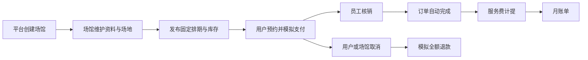
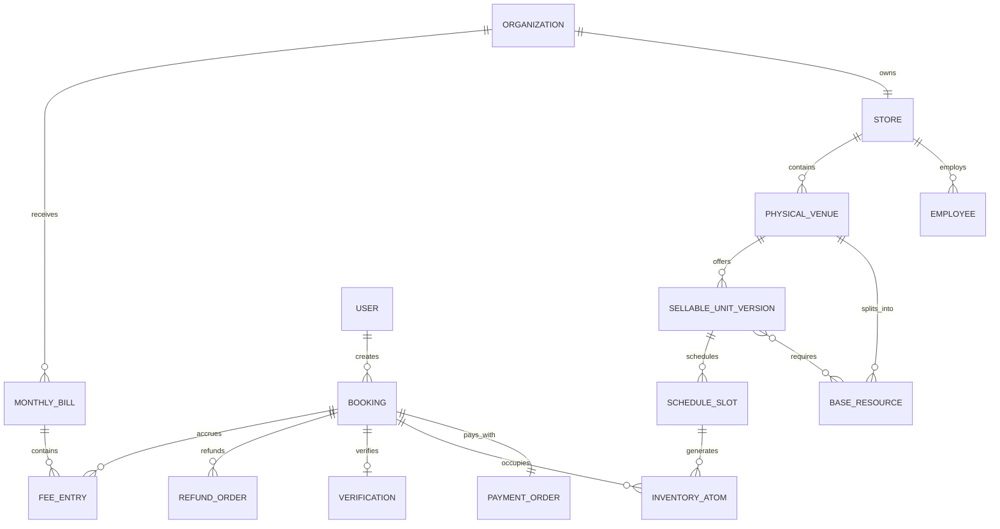

# 体育场地预约平台 MVP 需求基线

| 文档属性 | 内容 |
| --- | --- |
| 版本 | MVP 功能闭环版 V0.2 |
| 状态 | 技术封板（Mock 功能闭环） |
| 更新日期 | 2026-08-11 |
| 权威来源 | `PLAN.md`（MVP 范围覆盖层）、`PRD.md`（完整产品愿景） |
| 使用环境 | `dev`、`test` |

## 1. 文档目的与效力

本文把已评审通过的 `PLAN.md` 转换为页面、权限、状态、接口和验收基线，供原型评审、数据建模和后续编码使用。

- 本文只覆盖 MVP 功能闭环版，不代表可生产上线。
- `PLAN.md` 与 `PRD.md` 冲突时，MVP 以 `PLAN.md` 为准。
- 本文在原型评审通过前属于评审草案；评审通过后，功能变更应先更新本文再排期。
- 真实支付、生产部署与合规要求属于独立里程碑，不得通过 Mock 能力验收后直接上线。

## 2. MVP 目标与边界

### 2.1 目标闭环



### 2.2 本阶段实现

- 平台创建、启停经营主体和单门店场馆，创建场馆管理员。
- 平台维护运动分类和出租类型，查看全局订单与审计记录。
- 场馆维护资料、物理场地、可售单元、店员、固定排期、特殊日期和人工占用。
- 支持固定的全场、A 半场、B 半场组合库存，使用 30 分钟原子库存保证冲突正确性。
- 用户查询场馆和固定时段，创建待支付订单，完成模拟支付、取消和模拟全额退款。
- 员工通过微信身份绑定，使用二维码或 6 位短码核销。
- 未取消订单到期自动完成；系统生成服务费明细、月账单和退款调整。
- PC 管理端默认脱敏手机号，完整号码查看需要授权并留审计记录。

### 2.3 明确延期

- 真实支付、真实退款、自动分佣、银行卡到账和生产财务报表。
- 用户自由连选、15 分钟预约单位和任意资源组合。
- 多门店管理界面、集团报表及自定义角色。
- 场馆自助入驻、资料审核与驳回流程。
- 售后工单、部分退款、退款模板和在线协商。
- 完整线下订单、发票、优惠券、会员、评价、课程和赛事。
- 定位、附近排序、多城市切换和推荐算法。

## 3. 角色与数据范围

| 角色 | 终端 | 数据范围 | 关键权限 |
| --- | --- | --- | --- |
| 平台管理员 | PC | 全平台 | 创建/启停场馆、创建场馆管理员、维护字典、查看全局订单与审计、处理账单及人工全额退款 |
| 场馆管理员 | PC | 当前经营主体及唯一门店 | 维护场馆、场地、排期、人工占用、店员、订单、核销记录和账单 |
| 预约用户 | 微信小程序 | 本人数据与公开场馆数据 | 查询、预约、模拟支付、取消、查看核销凭证 |
| 核销店员 | 微信小程序 | 所属门店及本人核销记录 | 绑定身份、扫码/短码核销、查看本人记录 |

权限基线：

- 服务端从认证身份和成员关系推导 `organization_id`、`store_id`，不信任客户端传入的数据范围。
- 场馆管理员不能创建另一个场馆管理员。
- 核销店员不能修改订单、价格、排期或场馆资料，也不能查看完整手机号。
- 平台管理员和场馆管理员默认查看脱敏手机号；查看完整号码必须记录操作者、原因和时间。
- MVP 不提供完整手机号批量导出。

## 4. 通用业务约定

| 项目 | 约定 |
| --- | --- |
| 时区 | 业务展示使用 `Asia/Shanghai`；服务端时间存储使用 UTC |
| 时间粒度 | 30 分钟原子，开始和结束时间必须对齐 |
| 金额 | 人民币分，整数存储和传输 |
| 支付锁 | 10 分钟，持久化保存占用者与过期时间 |
| 最短提前预约 | 默认 30 分钟，门店可配置 |
| 最远预约窗口 | 默认未来 7 天，门店可配置 |
| 核销窗口 | 预约开始前 30 分钟至预约结束 |
| 用户未支付上限 | 全平台同时最多 2 笔 |
| 创建频率 | 用户 10 分钟最多 5 次；设备/来源 10 分钟最多 20 次 |
| 冷却规则 | 30 分钟内 3 次自然过期后冷却 15 分钟 |
| 取消规则 | 开始前且未核销可由用户全额取消；场馆开始前可填写原因后全额取消 |
| Mock 隔离 | `dev`、`test` 可用；`prod` 不得创建 Mock 资金记录 |

## 5. 核心领域对象



### 5.1 组合库存

- 一个物理场地首期固定拆成 A、B 两个基础资源。
- 全场版本引用 `[A, B]`，A 半场引用 `[A]`，B 半场引用 `[B]`。
- 可售单元的资源组合不可变；变更组合时创建新版本。
- 排期、库存、订单都保存 `sellable_unit_version_id`。
- 被引用的版本和基础资源禁止物理删除。

### 5.2 排期与库存

- 周模板生成固定可售时段，特殊日期完整覆盖当天周模板。
- 发布时生成窗口内 30 分钟库存原子，并保存排期版本。
- 排期变更不覆盖 `PAYMENT_LOCKED`、`PROCESSING`、`UNKNOWN`、已预约或人工占用库存。
- 旧占用释放时若排期版本已变化，库存进入 `RECONCILE_PENDING`，重建完成前不得对外可售。

## 6. 页面与权限基线

### 6.1 平台 PC 管理端

| 页面 | 核心展示 | 核心操作 |
| --- | --- | --- |
| 登录 | 用户名、密码、本地二次验证码 | 登录、首次修改密码 |
| 平台概览 | 场馆数、今日预约、待处理异常、未付账单 | 跳转明细 |
| 场馆管理 | 名称、状态、管理员、创建时间 | 新建、启用、暂停、重置管理员密码 |
| 运动分类 | 两级树、编码、名称、排序、状态 | 新建、编辑、启停 |
| 出租类型 | 运动项目、名称、状态 | 新建、编辑、启停 |
| 全局订单 | 订单号、场馆、时段、金额、订单/支付状态 | 筛选、查看详情、授权查看完整手机号 |
| 月账单 | 账期、场馆、服务费、调整、状态、到期日 | 查看、记录线下收款、标记已支付 |
| 审计记录 | 操作者、动作、对象、时间、结果 | 筛选、查看详情 |

### 6.2 场馆 PC 管理端

| 页面 | 核心展示 | 核心操作 |
| --- | --- | --- |
| 经营看板 | 今日预约、待核销、已核销、未核销、已完成、已取消、利用率、7 天趋势 | 跳转订单 |
| 场馆资料 | 名称、介绍、地址、电话、坐标、图片、设施、入场须知 | 编辑并立即生效 |
| 场地资源 | 物理场地、基础资源、可售单元版本、出租类型 | 新建场地、创建新组合版本、上下架 |
| 排期管理 | 周模板、固定时段、总价、特殊日期 | 新增、修改、发布 |
| 库存日历 | 日期、时段、可售单元、库存状态、占用来源 | 筛选、查看冲突 |
| 人工占用 | 场地、时段、原因、操作人 | 创建、取消未来占用 |
| 订单管理 | 用户、联系方式、场地、时段、金额、状态 | 查看、场馆取消、授权查看完整手机号 |
| 店员管理 | 姓名、状态、微信绑定状态、最近核销 | 新增、停用、生成绑定码、发起重绑 |
| 核销记录 | 订单、店员、方式、结果、时间 | 筛选、查看失败原因 |
| 服务费明细 | 订单、计费基数、费率、金额、类型 | 筛选、查看来源 |
| 月账单 | 账期、正向费用、调整、应付、状态 | 查看账单与凭证 |

### 6.3 用户微信小程序

| 页面 | 核心展示 | 核心操作 |
| --- | --- | --- |
| 场馆列表 | 场馆图片、名称、项目、区域、起价 | 筛选、进入详情 |
| 场馆详情 | 介绍、设施、地址、电话、入场须知、可售日期 | 选择日期和固定时段 |
| 确认预约 | 场地、时段、联系人、实付金额、取消规则 | 提交预约 |
| 模拟支付 | 订单号、金额、倒计时、Provider 标识 | 模拟成功、模拟处理中、放弃支付 |
| 订单列表 | 待支付、已确认、已完成、已取消 | 筛选、进入详情 |
| 订单详情 | 状态、场地、时段、金额、支付/退款、联系人 | 支付、取消、展示核销凭证 |
| 核销凭证 | 动态二维码、6 位短码、有效窗口 | 刷新动态凭证 |

### 6.4 核销员工微信小程序入口

| 页面 | 核心展示 | 核心操作 |
| --- | --- | --- |
| 身份绑定 | 场馆、店员、绑定码状态 | 输入/扫描绑定码 |
| 核销首页 | 所属门店、今日核销数 | 扫码、输入短码 |
| 核销确认 | 订单、场地、时段、脱敏用户 | 确认核销、返回 |
| 核销结果 | 成功或失败、首次核销员工和时间、失败原因 | 返回首页、查看记录 |
| 本人记录 | 订单、场地、方式、结果、时间 | 筛选今日记录 |

## 7. 状态机基线

### 7.1 订单状态

```text
PENDING_PAYMENT
  ├─ 支付成功 ─────────────→ CONFIRMED ── 到达结束时间 ─→ COMPLETED
  ├─ 用户放弃/安全关单 ───→ CANCELLED
  └─ 过期且确认未支付 ────→ CANCELLED

CONFIRMED
  ├─ 用户开始前且未核销取消 ─→ CANCELLED
  └─ 场馆开始前取消 ─────────→ CANCELLED
```

- `VERIFIED` 不是订单状态，由独立核销事实表达。
- 已取消订单不得恢复；晚到支付创建退款义务，不抢回库存。
- 用户取消、场馆取消和核销通过同一订单行锁串行。

### 7.2 库存状态

| 状态 | 含义 | 可对外售卖 |
| --- | --- | --- |
| `AVAILABLE` | 当前排期版本下可售 | 是 |
| `PAYMENT_LOCKED` | 被待支付订单持久占用 | 否 |
| `PROCESSING` | 支付结果处理中 | 否 |
| `UNKNOWN` | 支付结果未知，等待查询/关单 | 否 |
| `BOOKED` | 已支付确认 | 否 |
| `INTERNAL_BLOCKED` | 人工占用或场馆取消后继续封锁 | 否 |
| `RECONCILE_PENDING` | 等待按最新排期版本重建 | 否 |

### 7.3 支付状态

```text
CREATED → PROCESSING → SUCCEEDED
                    ├→ FAILED
                    ├→ CLOSED
                    └→ UNKNOWN → PROCESSING / SUCCEEDED / CLOSED
```

- 支付状态未知时不得释放库存。
- 回调先验签并写入持久化 inbox，再校验 Provider、商户、业务单号、金额和币种。
- 重复回调和主动查询并发只能推进合法的单向状态迁移。

### 7.4 退款状态

```text
REFUND_PENDING → REFUND_PROCESSING → REFUND_SUCCEEDED
                                  ├→ REFUND_UNKNOWN
                                  └→ PENDING_FUNDING（真实支付阶段）
```

- 取消、晚到支付和平台人工退款共用退款意图原语。
- 订单取消、取消记录、库存去向、退款义务和退款 outbox 在同一事务提交。
- Mock 退款失败不恢复订单或库存，继续重试或进入人工待办。

### 7.5 核销状态

| 状态 | 进入条件 |
| --- | --- |
| `UNVERIFIED` | 订单确认后的默认状态 |
| `VERIFIED` | 授权员工在有效窗口首次核销成功 |

- 重复核销返回首次成功结果，不创建第二条成功事实。
- 已取消、跨门店、窗口外和停用员工操作均拒绝并记录原因。

### 7.6 账单状态

```text
DRAFT → ISSUED → PAID
            └─ 到期未支付 → OVERDUE → PAID
```

- 完成满 24 小时且未全额退款的订单只生成一次正向服务费明细。
- 未支付账单发生退款时，在当前账期生成负向调整。
- 已支付账单发生退款时，在下一账期抵扣；不改写历史明细。

### 7.7 交易门禁

- 经营主体和门店分别保存交易门禁聚合行。
- 人工暂停、余额不足、风控等原因使用独立 blocker。
- 新增预约同时锁定并检查经营主体、门店两级门禁。
- 只有两级范围都没有活动 blocker 时才允许新增预约。

## 8. 核心业务流程

### 8.1 发布排期

1. 场馆选择可售单元版本并配置周模板固定段、总价和适用日期。
2. 服务端校验 30 分钟对齐、同版本时段冲突和门店数据范围。
3. 特殊日期存在时完整覆盖当天周模板。
4. 发布新排期版本，保留旧版本引用。
5. 对未占用的未来区间生成或重建原子库存。
6. 活动支付占用、已预约和人工占用保持不变；需要重建的旧占用释放后进入 `RECONCILE_PENDING`。

### 8.2 创建预约与模拟支付

1. 客户端提交固定时段、联系人和幂等键。
2. 服务端锁定交易门禁、用户占用配额和全部基础资源库存行。
3. 校验库存、频率、冷却、价格和排期版本。
4. 创建订单、支付单和 10 分钟持久化占用。
5. 事务提交后调用 `MockPaymentProvider`。
6. 模拟成功后订单进入 `CONFIRMED`、库存进入 `BOOKED`。
7. 模拟超时先查询 Provider，确认未支付并安全关单后才取消订单并释放库存。

### 8.3 取消与退款

1. 锁定订单行和订单资金锁。
2. 用户取消校验开始时间与核销事实；场馆取消校验开始时间并要求原因。
3. 同一事务写入订单取消、取消记录、库存去向、退款义务和退款命令 outbox。
4. 未支付订单不创建退款义务。
5. 事务提交后由消费者执行 Mock 退款，失败可重试。

### 8.4 核销与自动完成

1. 员工服务端会话确定所属门店，不接受客户端指定门店范围。
2. 二维码令牌按哈希定位订单；短码按 `(store_id, keyed_hash(short_code))` 唯一定位。
3. 锁定订单行，校验员工、门店、订单、时间窗口和首次核销事实。
4. 写入成功或失败记录；成功后立即注销凭证。
5. 到达结束时间后，幂等任务将未取消订单设为 `COMPLETED`，核销事实保持独立。

## 9. 接口契约基线

### 9.1 通用规则

- PC 使用安全 Cookie 会话与 CSRF 防护；小程序使用短期访问会话和单次轮换刷新凭证。
- 写接口统一接受 `Idempotency-Key`；同一身份、接口和键返回首次处理结果。
- 列表接口使用 `page`、`pageSize`，默认按创建时间倒序。
- 所有接口统一返回 `data`、`code`、`serviceCode`、`msg` 四个外层字段；分页结果固定放在 `data.current`、`data.size`、`data.total` 和 `data.records` 中，具体约定见 `docs/API-CONVENTIONS.md`。
- 错误也使用相同外层结构；字段错误、请求追踪号等附加信息只能置于 `data` 内，不能为错误响应另设外层字段。
- 时间输出使用 `yyyy-MM-dd HH:mm:ss`，未发生时间返回 `null`；金额字段以 `AmountFen` 或明确的 `...Fen` 命名。
- OpenAPI 是前后端共享契约，字段不得由两端分别维护。

### 9.2 首批接口分组

| 分组 | 首批能力 |
| --- | --- |
| `/api/admin/auth` | 登录、首次改密、退出、会话查询 |
| `/api/admin/organizations` | 场馆创建、启停、管理员创建/重置 |
| `/api/admin/catalog` | 运动分类、出租类型维护 |
| `/api/admin/orders` | 全局订单查询、详情、完整号码授权查看 |
| `/api/venue/profile` | 场馆资料查询与更新 |
| `/api/venue/resources` | 物理场地、基础资源、可售单元版本维护 |
| `/api/venue/schedules` | 周模板、特殊日期、发布和库存日历 |
| `/api/venue/blocks` | 人工占用创建与取消 |
| `/api/venue/employees` | 店员新增、停用、绑定码、重绑 |
| `/api/venue/orders` | 本场馆订单查询、详情和场馆取消 |
| `/api/mini/venues` | 公开场馆列表、详情、日期与固定时段 |
| `/api/mini/bookings` | 创建预约、本人订单、取消、核销凭证 |
| `/api/mini/payments` | Mock 支付创建、状态查询 |
| `/api/staff/binding` | 微信身份绑定与会话撤销 |
| `/api/staff/verifications` | 二维码预检、短码预检、确认核销、本人记录 |
| `/api/billing` | 服务费明细、月账单、收款记录和调整 |

身份与主体门店纵向切片的字段已冻结在 `docs/openapi.yaml`；其余接口分组在对应原型与数据模型评审完成后再补充，避免提前固化未确认字段。

## 10. MVP 验收基线

### 10.1 PRD 追踪矩阵

| 处理方式 | PRD 编号 | MVP 解释 |
| --- | --- | --- |
| 功能闭环版实现 | `VEN-02`、`INV-01`、`INV-03`、`ORD-01`–`ORD-04`、`CAN-02`、`VER-01`–`VER-03`、`PER-02` | 30 分钟原子；支付与退款使用 Mock Provider |
| 替代实现 | `INV-02` | 线上订单与人工占用共用库存；完整线下订单延期 |
| 真实支付里程碑 | `PAY-03`、`REC-01`、`REC-02` 及 `ORD-02`、`ORD-03` 的真实渠道版本 | 渠道确定后补充合同测试 |
| 选择分佣策略后实现 | `PAY-02`、`PAY-04`–`PAY-09` | 首期直收月账单不实现分账状态 |
| 延期 | `VEN-01`、`VEN-03`–`VEN-05`、`CAN-01`、`AFT-01`–`AFT-05`、`PAY-01`、`PAY-10`、`OFF-01`、`INV-04`、原 `PER-01` 财务角色 | 不进入本阶段验收 |

### 10.2 新增 MVP 验收场景

| 编号 | 场景 | 验收结果 |
| --- | --- | --- |
| MVP-SCP-01 | 全场与 A/B 半场冲突 | 全场占用 A、B；任一半场被占用时全场不可预约；A、B 可并行预约 |
| MVP-SCP-02 | 可售单元组合变更 | 创建新版本；旧订单、库存和取消释放继续引用原版本 |
| MVP-SCH-01 | 30 分钟固定时段发布 | 非 30 分钟对齐被拒绝；发布后用户端展示整段总价 |
| MVP-SCH-02 | 特殊日期覆盖 | 当天只执行特殊日期配置，不与周模板叠加 |
| MVP-INV-01 | 两用户并发预约同一基础资源 | 最多一个订单获得持久化支付占用 |
| MVP-INV-02 | 排期变更后释放旧占用 | 进入 `RECONCILE_PENDING`，重建前不出现在可售查询 |
| MVP-ORD-01 | 重复提交相同预约 | 返回首次结果，不重复订单、占用或支付单 |
| MVP-ORD-02 | 支付超时与成功回调并发 | 只能确认订单，或取消订单并创建一次晚到支付退款义务 |
| MVP-ORD-03 | 用户反复占坑 | 达到并发、频率或冷却阈值后拒绝，不可通过更换幂等键绕过 |
| MVP-CAN-01 | 取消事务后进程崩溃 | 重启后 outbox 唯一且可重试地完成退款，不丢失退款义务 |
| MVP-CAN-02 | 用户取消与核销并发 | 只能有一个符合规则的结果；两种事实不会同时首次成功 |
| MVP-VER-01 | 同门店短码碰撞 | 自动重试；活动短码在门店范围唯一 |
| MVP-VER-02 | 跨门店相同短码 | 只按认证员工所属门店定位，不越权 |
| MVP-AUTH-01 | 店员停用 | 已有店员会话立即失效，历史核销保留 |
| MVP-AUTH-02 | Redis 中断 | 登录、刷新、绑定和短码核销失败关闭；不绕过限流 |
| MVP-PER-01 | PC 查看用户手机号 | 平台和场馆管理员默认脱敏；授权查看完整号码留痕；店员不可见 |
| MVP-GATE-01 | 暂停与创建预约并发 | 以同一门禁行提交顺序决定结果；暂停后不能创建新占用 |
| MVP-GATE-02 | 多暂停原因重叠 | 解除一个 blocker 后门禁仍保持关闭，直到全部原因解除 |
| MVP-BIL-01 | 服务费重复计提 | 同一订单只产生一条正向明细，金额按固化费率四舍五入到分 |
| MVP-BIL-02 | 已支付账单后退款 | 下一账期产生负向抵扣，不改写历史账单和明细 |

## 11. 非功能与安全基线

- MySQL 是库存、占用、会话撤销和业务状态的最终事实来源。
- Redis 只用于缓存、限流和短期凭证加速，不作为库存正确性的唯一保障。
- 密码使用 Argon2id 或 bcrypt；PC 使用 `HttpOnly`、`Secure`、`SameSite` Cookie。
- 二维码令牌至少 128 位随机熵且只保存哈希；店员绑定码同样只保存哈希、10 分钟过期且仅使用一次。
- 6 位短码使用带密钥哈希，按门店限制尝试次数并在连续失败后锁定。
- 订单、库存、支付、退款、核销、计费和账单状态迁移记录原因、操作者和请求 ID。
- `PROCESSING/UNKNOWN` 超过 15 分钟告警，超过 2 小时进入人工待办。
- 库存任务连续 5 分钟未成功、自动任务水位落后 15 分钟或发现重复占用时告警。
- 日志不得记录密码、会话凭证、完整手机号、二维码原始令牌或支付密钥。

## 12. 原型评审门

原型评审需要逐项确认：

- [ ] 四类角色的导航、页面和数据范围正确。
- [ ] 页面字段足以完成核心流程，没有混入延期范围。
- [ ] 每个页面只有符合角色权限的操作。
- [ ] 全场/A/B 半场、固定时段和人工占用表达清楚。
- [ ] 订单、支付、退款、核销、库存和账单状态名称无歧义。
- [ ] 用户取消、场馆取消、核销与暂停的边界得到确认。
- [ ] PC 默认手机号脱敏、完整号码查看留痕得到确认。
- [ ] 错误提示和空状态提供明确恢复动作。
- [ ] 同一演示订单可从用户创建一路追踪到后台订单、库存、核销记录、自动完成和账单明细。
- [ ] 本文的 PRD 追踪矩阵得到产品确认。

评审结论与实现基线：

1. `docs/openapi.yaml` 已冻结 Mock MVP 的请求、响应、错误码和幂等语义，统一响应为 `code`、`serviceCode`、`msg`、`data`。
2. `docs/DATA-MODEL.md` 已冻结实体、主外键、唯一约束、版本关系和全部业务表公共审计字段。
3. `backend/`、`admin-web/`、`miniapp/` 已实现完整 Mock 流程；原型中定义的关键角色与状态转换均可通过真实接口验证。
4. 真实支付、生产部署、公开试点和合规材料属于下一里程碑，不改变本 MVP 的 Mock 范围。
5. 2026-08-11 已完成 T-12 复验：后端打包、MySQL Flyway V1 至 V11、运行态全链路、管理端与用户端浏览器冒烟均通过；Redis 中断时管理端登录、小程序登录与刷新、店员绑定与刷新、短码核销均返回失败关闭，Redis 恢复后主链路可继续执行。
6. 本次结论仅表示技术封板；第 12 节中的产品原型评审与 PRD 追踪矩阵确认仍由产品负责人单独签收。

## 13. 尚未阻塞本阶段的外部决策

- 真实支付渠道、商户主体、退款授权和是否采用分佣策略。
- 平台服务费率、账期、税务和逾期处理合同条款。
- 微信小程序 AppID、云资源、域名备案和生产合规材料。
- 生产告警阈值、日志平台和密钥管理产品选型。

这些事项不阻塞 Mock 功能闭环开发，但应在第一阶段中段前启动，以免阻塞真实试点里程碑。
